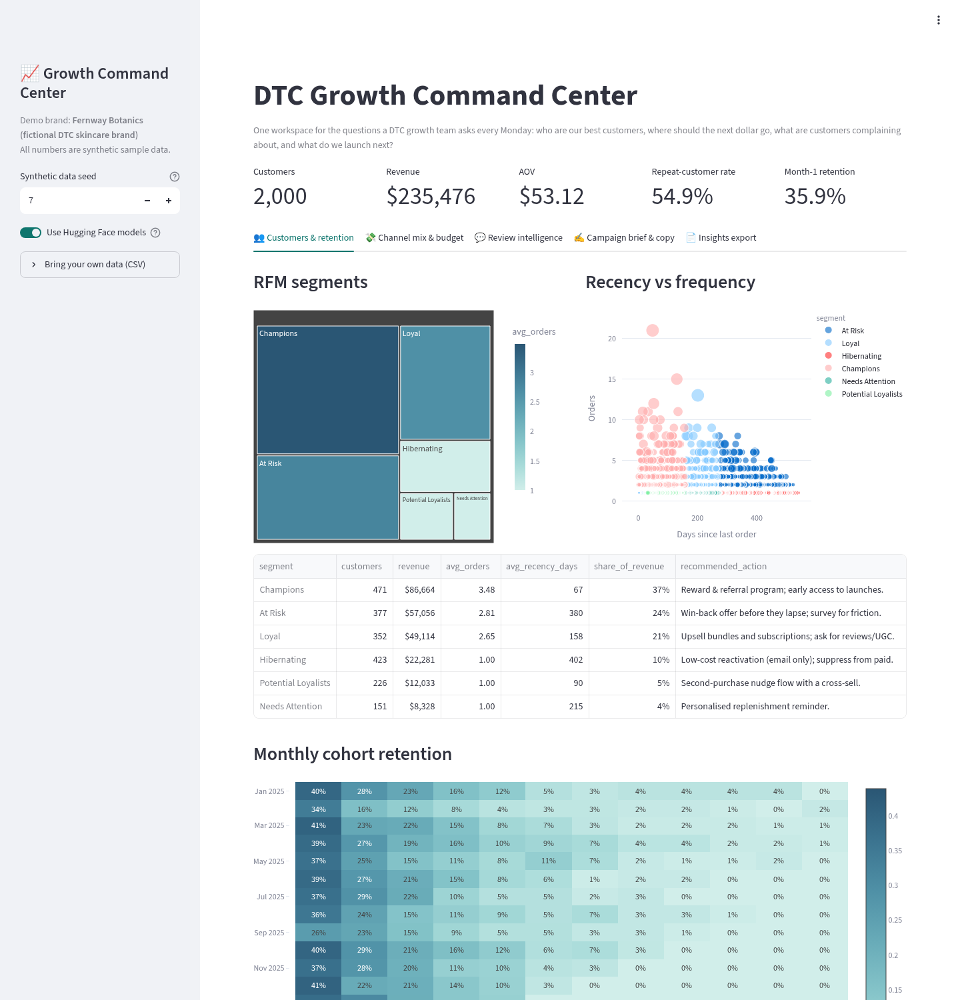
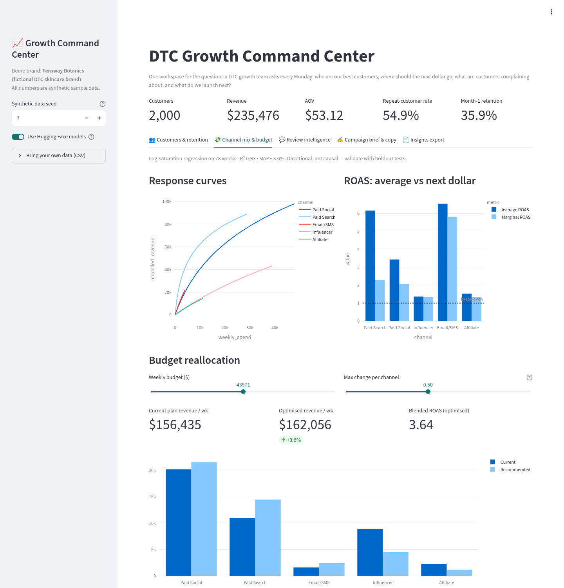
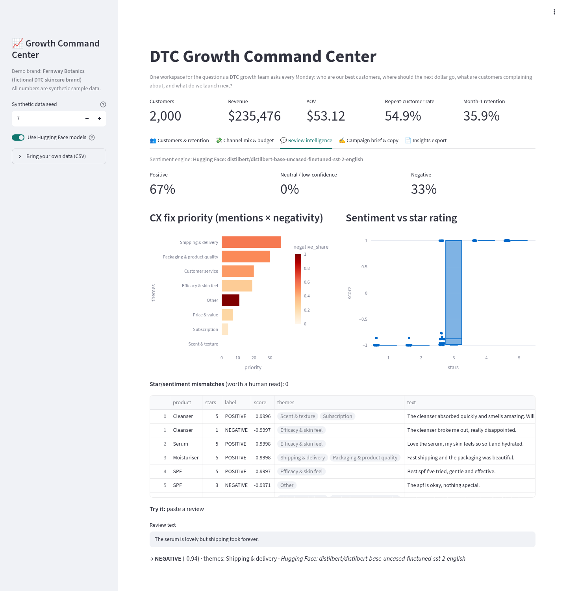
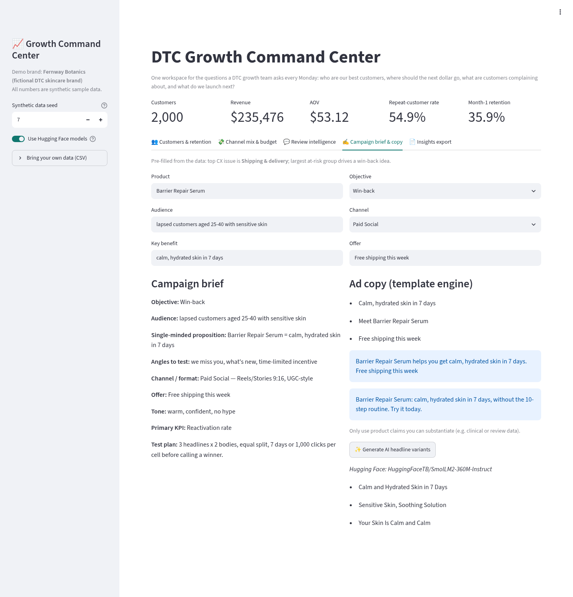
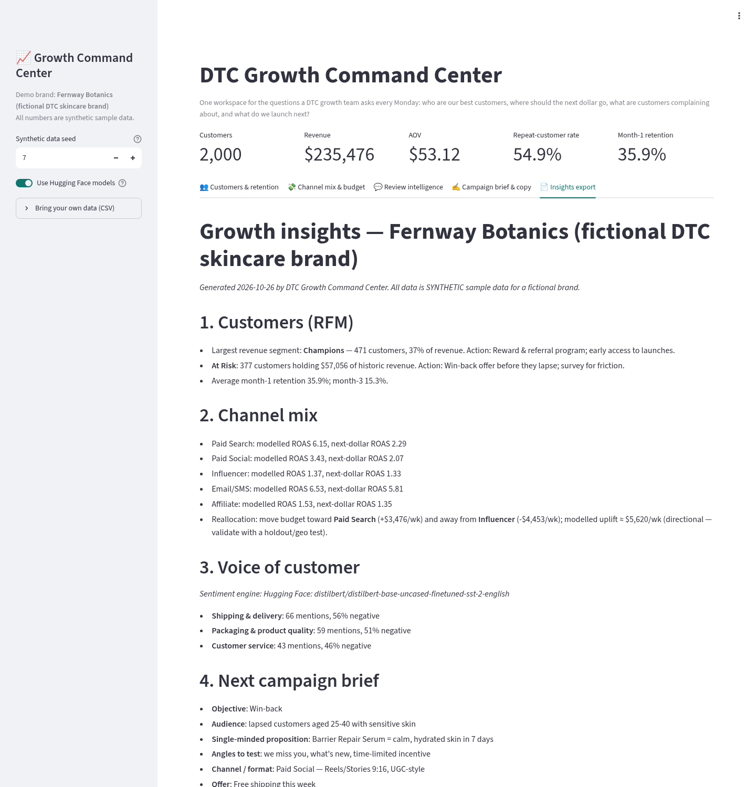
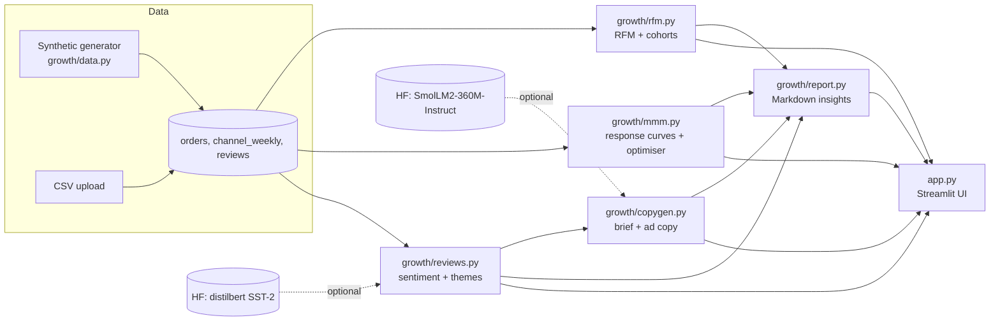

# DTC Growth Command Center

**One Streamlit workspace for the four questions a DTC growth team asks every Monday:**
who are our best customers, where should the next marketing dollar go, what are customers complaining about, and what campaign do we run next?

It combines customer analytics (RFM + cohort retention), a lightweight marketing-mix model with a budget optimiser, Hugging Face–powered review intelligence and an AI-assisted campaign brief generator, then rolls everything into an exportable insights report.

> ⚠️ **All data in this repo is synthetic.** "Fernway Botanics" is a fictional DTC skincare brand generated by `growth/data.py`. No figures relate to any real company. You can upload your own CSVs from the sidebar.



---

## The problem

DTC teams usually answer these questions in four different tools (Shopify/Klaviyo exports, an ad-platform spreadsheet, a reviews app and a Google Doc brief), so insights rarely connect. For example, the CX issue driving negative reviews never makes it into the win-back campaign brief. This app puts the whole loop in one place:

**Customers → Channels → Voice of customer → Next campaign → Shareable summary**

## Features

| # | Module | What it does | Technique |
|---|---|---|---|
| 1 | 👥 **Customers & retention** | Scores every customer on Recency, Frequency, Monetary value, maps them into 7 actionable segments (Champions, At Risk, Hibernating, etc.), each with a recommended CRM action, plus a monthly cohort retention heatmap | Quintile RFM scoring, cohort analysis |
| 2 | 💸 **Channel mix & budget** | Fits a response curve per channel (Paid Social, Paid Search, Email/SMS, Influencer, Affiliate), compares average vs **next-dollar (marginal) ROAS**, and recommends a budget reallocation with sliders for total budget and max change per channel | Log-saturation regression (NNLS + grid search on saturation), constrained optimisation (SciPy SLSQP) |
| 3 | 💬 **Review intelligence** | Classifies review sentiment with a Hugging Face model, tags CX themes (shipping, packaging, price, service…), ranks themes by **fix priority = mentions × negativity**, and flags star/sentiment mismatches | [`distilbert/distilbert-base-uncased-finetuned-sst-2-english`](https://huggingface.co/distilbert/distilbert-base-uncased-finetuned-sst-2-english), with a rule-based fallback |
| 4 | ✍️ **Campaign brief & copy** | Generates a structured brief (proposition, angles to test, KPI, test plan) and channel-length-aware ad copy; optional AI headline variants | Template engine + [`HuggingFaceTB/SmolLM2-360M-Instruct`](https://huggingface.co/HuggingFaceTB/SmolLM2-360M-Instruct) (optional) |
| 5 | 📄 **Insights export** | Auto-written Markdown summary of all of the above, ready to paste into Notion/Slack or download | — |

Also includes **bring your own data** (CSV upload for orders, weekly channel spend and reviews, see `sample_data/` for the formats), a seed control to regenerate the synthetic dataset, and graceful fallbacks so the app still works offline or without a GPU.

## Screenshots

| Channel mix & budget optimiser | Review intelligence |
|---|---|
|  |  |
| **Campaign brief & AI copy** | **Insights export** |
|  |  |

## Architecture



All analytics live in the UI-free `growth/` package, so every piece is unit-tested independently of Streamlit.

### How the budget optimiser works

For each channel *c*, weekly revenue contribution is modelled as

`revenue_c = β_c · ln(1 + spend_c / k_c) · season`

so every extra dollar earns less than the one before (diminishing returns). Marginal ROAS is `β_c / (k_c + spend_c)`. The optimiser maximises total predicted revenue for a fixed budget, within ±X% of current spend per channel. At the optimum, marginal ROAS is roughly equal across the channels that aren't capped, which is the classic "equalise the next-dollar return" rule. This is a **directional, explainable model, not a causal MMM**: use it to pick which holdout or geo tests to run, not to move real budgets on its own.

## Run it locally

```bash
git clone https://github.com/yashsarkar1806-creator/dtc-growth-command-center.git
cd dtc-growth-command-center
python -m venv .venv && source .venv/bin/activate
pip install -r requirements.txt          # includes transformers + torch
streamlit run app.py
```

Lightweight mode (no PyTorch or model downloads, much smaller install):

```bash
pip install -r requirements-core.txt
USE_HF_MODELS=0 streamlit run app.py
```

The first run with Hugging Face models downloads about 270 MB (sentiment) and about 720 MB (copy model, only when you click *Generate AI headline variants*).

## Tests

```bash
pytest -q
```

22 tests cover RFM scoring and segment rules, cohort maths, model fit and recovery of a known curve, optimiser constraints (budget, bounds, no revenue loss, equal marginal ROAS), sentiment and theme logic, model-failure fallbacks, copy character limits, report sections, and a headless Streamlit smoke test (`streamlit.testing`) that runs the whole app and moves the budget slider.

## Deploy to Hugging Face Spaces

Streamlit Spaces now use the **Docker SDK** (see the [Spaces Streamlit docs](https://huggingface.co/docs/hub/spaces-sdks-streamlit)), and this repo already includes a `Dockerfile` that serves on port 7860.

1. Create a new Space at <https://huggingface.co/new-space> and choose **Docker** (blank template).
2. Push this repo to the Space:
   ```bash
   git remote add space https://huggingface.co/spaces/<your-username>/dtc-growth-command-center
   git push space main
   ```
3. Add this YAML header to the top of the Space's `README.md` (Spaces reads its config from it):
   ```yaml
   ---
   title: DTC Growth Command Center
   emoji: 📈
   colorFrom: green
   colorTo: blue
   sdk: docker
   app_port: 7860
   ---
   ```
4. The free CPU tier is enough. To keep the Space light, set the variable `USE_HF_MODELS=0` in *Settings → Variables*, or leave it on and let the models download on first use.

See also: [Docker Spaces docs](https://huggingface.co/docs/hub/spaces-sdks-docker).

## Project structure

```
app.py                      Streamlit UI (5 tabs)
growth/
  data.py                   synthetic data generator (fictional brand)
  rfm.py                    RFM segmentation + cohort retention
  mmm.py                    response-curve model + budget optimiser
  reviews.py                HF sentiment + fallback + theme tagging
  copygen.py                campaign brief, ad copy, optional HF generation
  report.py                 Markdown insights export
tests/                      pytest suite (incl. Streamlit AppTest smoke test)
sample_data/                CSV templates for bring-your-own-data
scripts/capture_screenshots.py  regenerates README screenshots (Playwright)
Dockerfile                  HF Spaces / container deploy
```

## Ideas to extend

- Swap in a 3-class review model such as [`cardiffnlp/twitter-roberta-base-sentiment-latest`](https://huggingface.co/cardiffnlp/twitter-roberta-base-sentiment-latest)
- Benchmark the review module on public data: [`McAuley-Lab/Amazon-Reviews-2023`](https://huggingface.co/datasets/McAuley-Lab/Amazon-Reviews-2023) or [`fancyzhx/amazon_polarity`](https://huggingface.co/datasets/fancyzhx/amazon_polarity)
- Add adstock (carry-over) to the channel model, or compare with a Bayesian MMM
- Predict CLV with BG/NBD + Gamma-Gamma

## License

MIT, see [LICENSE](LICENSE). The Hugging Face models are used under their own licenses.

---

Built by Yash Sarkar as a portfolio project for growth, CX and digital marketing roles. More projects: [marketing-ai-ideas](https://github.com/yashsarkar1806-creator/marketing-ai-ideas).
